<p align="center">
  
</p>

<h1 align="center">MaterialTV</h1>

<p align="center">
  <strong>A Material 3 Expressive home screen for Amazon Fire TV.</strong><br>
  A calm, ad-free launcher with a screensaver worth watching, a sleep timer, and a setup that can declutter your Fire TV and undo it all again.
</p>

<p align="center">
  <a href="https://github.com/Brick-Bread/MaterialTV/releases/latest"></a>
  <a href="LICENSE"></a>
  
  
  <a href="https://github.com/Brick-Bread/MaterialTV/releases"></a>
</p>

<h3 align="center">
  <a href="https://github.com/Brick-Bread/MaterialTV/releases/latest/download/m3home.apk">Download APK</a>
  &nbsp;·&nbsp;
  <a href="https://brick-bread.github.io/MaterialTV/">Website</a>
  &nbsp;·&nbsp;
  <a href="https://brick-bread.github.io/MaterialTV/setup.html">Setup page</a>
</h3>

---

## Highlights

- **Uniform tiles.** Every app gets the same tonal card, coloured from its own icon, that springs up with a purple ring when focused. Swap in your own artwork if you like.
- **Hold Home for settings.** Holding the Home button opens MaterialTV's own side-sheet settings instead of Amazon's quick menu.
- **A real screensaver.** A big expressive clock, drifting Material shapes, or a slideshow of your own photos and silent live wallpapers.
- **Sleep timer and bedtime.** Fall asleep to a show: a gentle one-minute wind-down, and a calm night-sky scene at bedtime.
- **Brightness and blue light filter.** Dim and warm the picture, even on HDMI sticks with no real brightness control.
- **Widgets.** Weather (Open-Meteo, no key or account), deadlines and a countdown, now playing, and Tailscale status.
- **Reversible setup.** Optional debloat and privacy, SmartTube and Tailscale, set up from your phone or computer. Every change is recorded and can be undone.
- **No account, no tracking.** No analytics, no ads, no servers of its own. Plain Java, no Gradle, one small library (ZXing).

## What's new in 1.8.1

- **Wallpaper themes on demand.** The abstract, nature, space and city screensaver themes are downloaded when you switch a theme on in Settings, and deleted again when you switch it off, so they only take up space while you use them.
- **Phone setup fixed.** Setting up from a phone now installs SmartTube and Tailscale properly, instead of stopping with "Can't open file".
- **Long app names scroll** across their tile when it's focused.
- **Setup wizard layout** no longer cuts off the buttons.

## Screenshots

<table>
  <tr>
    <td width="50%">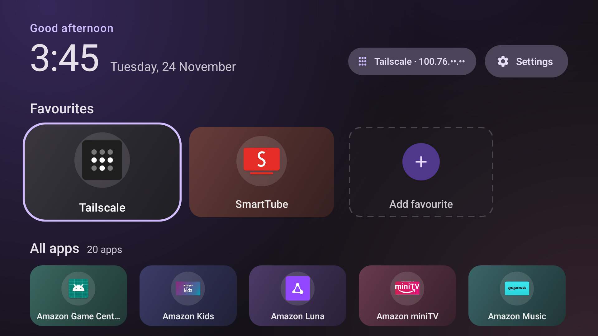<br><sub><b>Home screen.</b> Favourites and All apps, with the Tailscale chip and Settings.</sub></td>
    <td width="50%">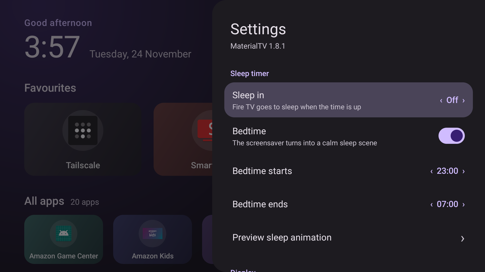<br><sub><b>Settings panel.</b> Hold Home to open it from anywhere: sleep timer, bedtime and more.</sub></td>
  </tr>
  <tr>
    <td>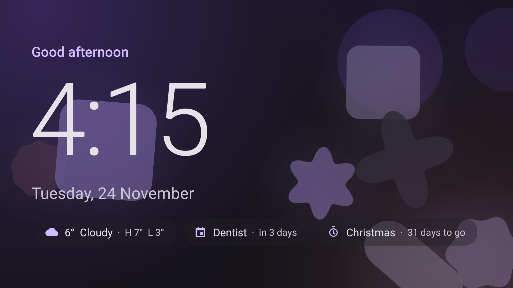<br><sub><b>Clock screensaver</b> with weather, deadline, countdown and Tailscale chips.</sub></td>
    <td>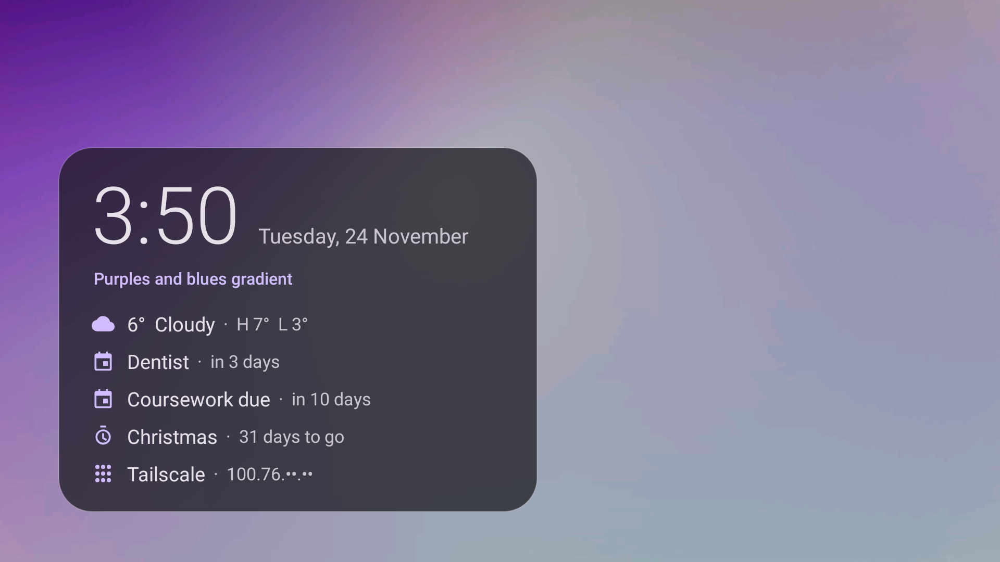<br><sub><b>Slideshow.</b> A glass card shows the time, the picture's name and your widgets.</sub></td>
  </tr>
  <tr>
    <td>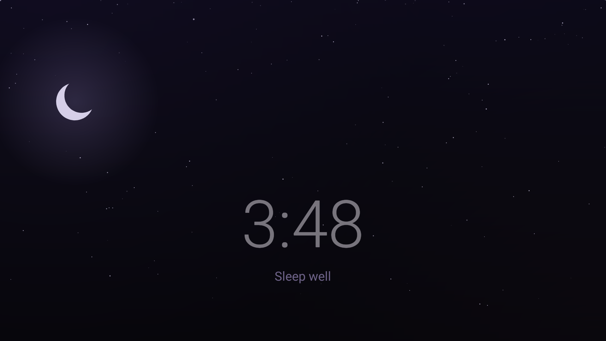<br><sub><b>Bedtime.</b> A dark sky, stars, a moon and a dim clock.</sub></td>
    <td>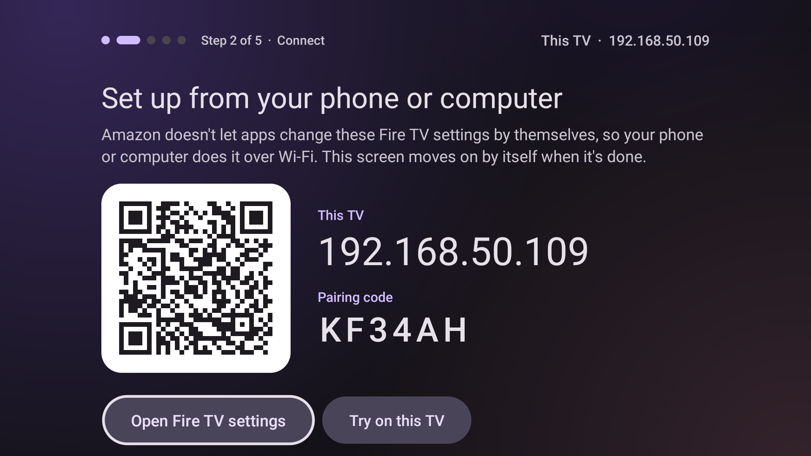<br><sub><b>Setup.</b> Scan the QR code with a phone, or use the TV's address and pairing code on a computer.</sub></td>
  </tr>
</table>

<details>
<summary><b>More screenshots</b></summary>
<br>
<table>
  <tr>
    <td width="50%">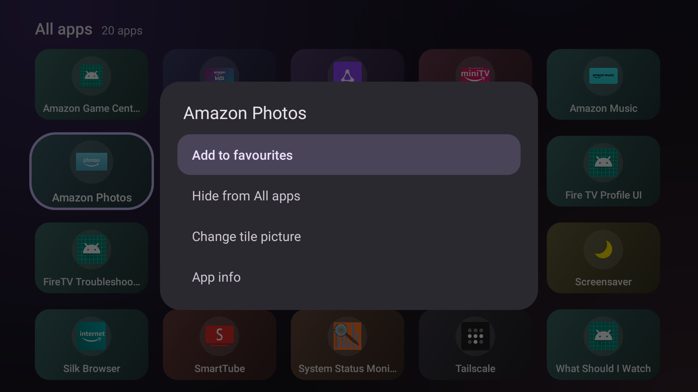<br><sub><b>Tile menu.</b> Press ≡ on any tile to favourite, hide or change its picture.</sub></td>
    <td width="50%">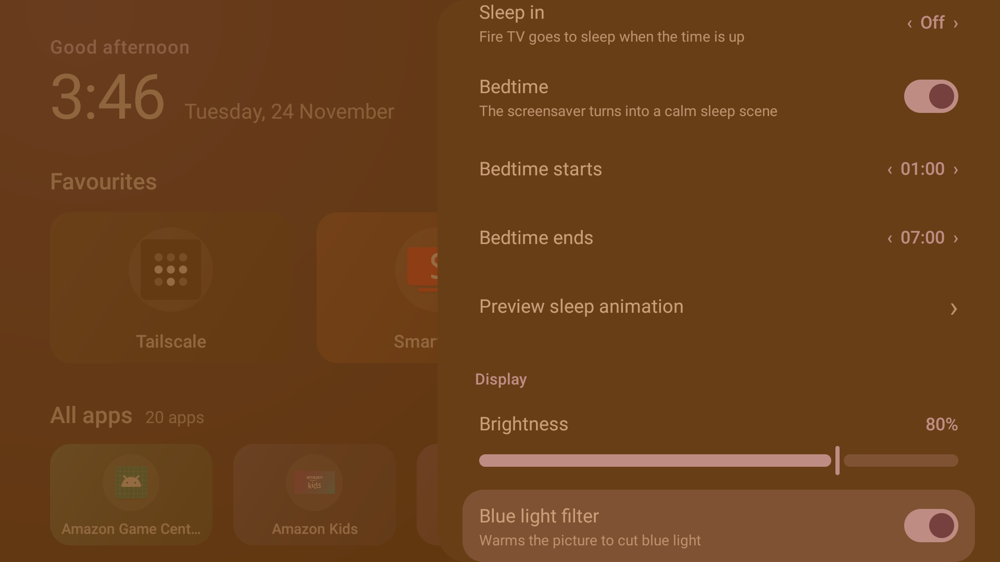<br><sub><b>Blue light filter</b> turned on in Settings.</sub></td>
  </tr>
  <tr>
    <td>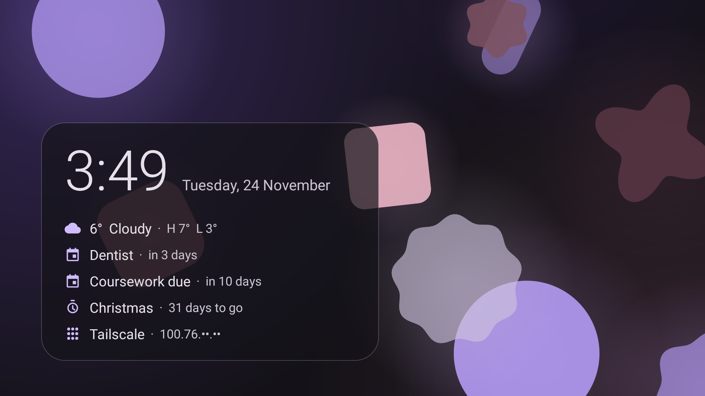<br><sub><b>Shapes screensaver.</b> Material shapes float and morph behind a glass card with the time and widgets.</sub></td>
    <td>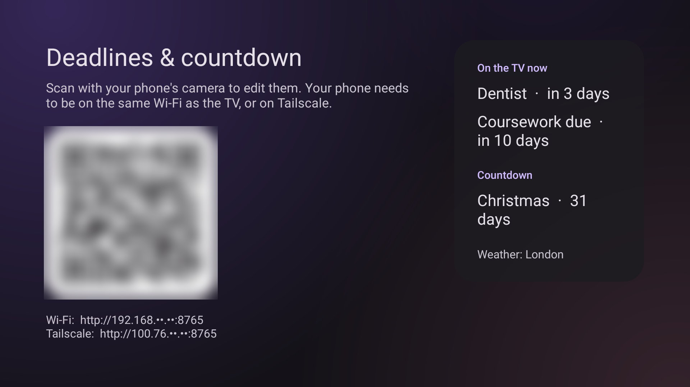<br><sub><b>Deadlines and countdown.</b> Scan to edit them from your phone.</sub></td>
  </tr>
  <tr>
    <td colspan="2" align="center">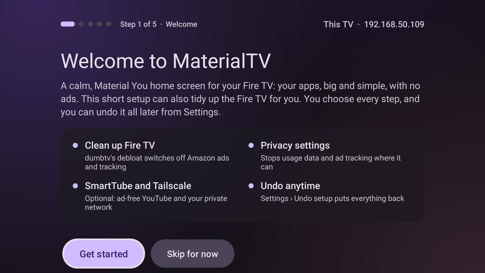<br><sub><b>Setup wizard</b> on first launch. Every step is optional.</sub></td>
  </tr>
</table>
</details>

## Contents

[Install](#install) · [Setup](#setup) · [Undo & uninstall](#undo--uninstall) · [Features](#features) · [Privacy](#privacy) · [FAQ](#faq) · [Build from source](#build-from-source) · [Credits & licences](#credits--licences)

## Install

Most people install MaterialTV with the free **Downloader** app on the Fire TV.

1. On the Fire TV, open **Settings › My Fire TV › Developer options** and turn on **ADB debugging** (setup needs it, see the [FAQ](#faq) for why). Turn on **Apps from Unknown Sources**, or on newer Fire OS, **Install unknown apps** for Downloader.
   > Don't see Developer options? Open **Settings › My Fire TV › About**, select your device name seven times, then go back.
2. Install **Downloader** (by AFTVnews) from the Amazon Appstore.
3. In Downloader, type the code **`4403805`** and press **Go**.
   Or enter this link instead. It always points to the newest release:
   ```
   https://github.com/Brick-Bread/MaterialTV/releases/latest/download/m3home.apk
   ```
   Or type `brick-bread.github.io/MaterialTV` and select **Download APK** there.
4. Choose **Install**, then **Open**. The setup wizard starts. Follow [Setup](#setup) below.
5. Press **Home**. That's it: Home now opens MaterialTV, and holding Home opens its settings.

Each release also publishes `m3home.apk.sha256`. To build it yourself, see [Build from source](#build-from-source).

## Setup

Fire OS doesn't let you pick a different home app, and some permissions can only be granted over ADB. Since **Fire OS 7.6.6.9**, Amazon also stops apps on a Fire TV from using that TV's own ADB. So MaterialTV's setup runs from **another device on the same Wi-Fi**: an Android phone or a computer.

The TV's setup wizard shows a **QR code**, the **TV's address** and a **pairing code**. Pick one of these:

<table>
  <tr>
    <td valign="top">

### With an Android phone

The same `m3home.apk` also works as a **setup remote** on an Android phone.

1. Install MaterialTV on the phone (scan the TV's QR code with the phone's camera to open the [setup page](https://brick-bread.github.io/MaterialTV/setup.html), which links to the APK).
2. Open MaterialTV on the phone and tap **Scan the TV's code**. The built-in scanner reads the QR code and connects by itself.
3. Check that the pairing code on the phone matches the TV, then tap **Set up**.
4. On the TV, when it asks **"Allow USB debugging?"**, tick **Always allow** and press **OK**. Follow the steps on the phone.

The phone and TV must be on the same Wi-Fi network, or both on the same Tailscale network.

</td>
    <td width="280" valign="top" align="center">
      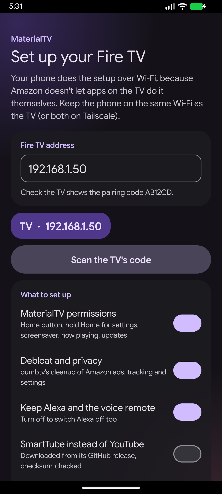
      <br><sub>Phone mode</sub>
    </td>
  </tr>
</table>

### With a computer

Replace `192.168.1.50` with the address shown on the TV (also in **Settings › My Fire TV › About › Network**). You don't need to install adb: if it isn't on your PATH, the script downloads Google's official platform-tools.

**Windows** (PowerShell):

```powershell
$env:M3_TV="192.168.1.50"; irm https://raw.githubusercontent.com/Brick-Bread/MaterialTV/main/scripts/setup.ps1 | iex
```

**Mac / Linux** (Terminal):

```bash
curl -fsSL https://raw.githubusercontent.com/Brick-Bread/MaterialTV/main/scripts/setup.sh | bash -s -- --tv 192.168.1.50
```

On the TV, tick **Always allow from this computer** and select **Allow** when asked. The TV's setup screen moves on by itself when it's done. Prefer to read the script first, or want the options (`-Undo`, `-Yes`)? See [`scripts/README.md`](scripts/README.md).

iPhone and iPad can't talk to a Fire TV's debugging connection, so use a computer or an Android phone.

### On the TV itself

On older Fire OS builds that still allow it, select **Try on this TV** on the setup screen and MaterialTV does everything itself with its own small ADB client (`Adb.java`). If Fire OS blocks it, the screen tells you to use a phone or computer instead.

### What setup can do

You pick the steps. Run it again any time from **Settings › Fire TV setup › Run setup**.

<details>
<summary><b>The steps in detail</b></summary>

- **MaterialTV permissions**
  - Turns on the Home button service (`HomeGuard`).
  - Grants `WRITE_SECURE_SETTINGS`, used for the screensaver and to turn its own service back on after an update.
  - Allows the now-playing listener.
  - Allows "install unknown apps" so it can offer GitHub updates.
  - Sets MaterialTV as the screensaver.
- **Debloat and privacy** (dumbtv's lists in `assets/setup/`)
  - Switches off about 37 Amazon ad and tracking apps. Apps in `never-disable.txt` are never touched.
  - For apps Amazon won't let you switch off (`protected.txt`), blocks running in the background and background data.
  - Applies 13 privacy settings (ad tracking, usage data, featured video autoplay and similar).
  - Optional: switch Alexa off too (`alexa.txt`). Alexa is kept by default.
- **SmartTube:** installs a pinned SmartTube release, checked against its SHA-256 before installing, and switches off the Amazon YouTube app.
- **Tailscale:** installs the official APK from `pkgs.tailscale.com`, checked against its published SHA-256, and sets it as the always-on VPN. Open Tailscale once on the TV to sign in.

Amazon apps are only switched off, never removed.

</details>

**Every change is recorded.** Setup keeps a change log on the TV at
`/sdcard/Android/data/app.m3home/files/setup/ledger.json`: which apps it switched off, each setting's previous value, and which apps it installed. The phone, the computer scripts and the TV all read and write the same file, so you can set up from one and undo from another.

## Undo & uninstall

Open **Settings › Fire TV setup › Undo setup / uninstall** on the TV. It shows a QR code, just like setup, so the undo runs from your phone or computer (or run the script with `-Undo` / `--undo`). Pick what to put back:

- **Debloat and privacy:** switches the apps back on, and restores the settings, background limits and background data.
- **SmartTube** (optional): removes SmartTube if setup installed it, and switches the Amazon YouTube app back on.
- **Tailscale** (optional): clears the always-on VPN, and removes Tailscale if setup installed it.
- **MaterialTV itself** (optional): gives Home back to Amazon, restores Amazon's screensaver, removes MaterialTV's accessibility service and now-playing listener, then uninstalls MaterialTV.

Undo uses the change log to put back exactly what was there. On a TV set up before the log existed (for example with dumbtv directly), it falls back to dumbtv's restore lists (`packages.txt`, `alexa.txt`, `settings.restore.txt`). Keep ADB debugging on until undo has finished.

## Features

### Home screen


- **Header:** a greeting, a large clock with the date, a **Tailscale chip** showing whether Tailscale is up and the stick's tailnet IP, and a **Settings** button.
- **Rows:** Favourites (with an "Add favourite" card), **Recently used**, and an **All apps** grid five tiles wide.
- **Tiles:** every tile is a tonal gradient taken from the app's own colours, with its sharpest icon and its name inside the card. When focused it springs up, its corners round out, a purple ring appears, and a long name scrolls so you can read all of it.
- **≡ (menu) or hold Select on a tile:** add or remove a favourite, move it left or right, hide it from All apps, **change the tile picture**, or open app info.
- **Home button:** pressing Home opens MaterialTV. **Holding Home** opens MaterialTV's settings instead of Amazon's quick menu.

<br clear="right">

### Settings panel

Open it with the Settings button, or hold Home.

<details>
<summary><b>Everything in the panel</b></summary>

- **Sleep timer:** off, or 15 minutes to 2 hours.
- **Bedtime** (default 23:00 to 07:00).
- **Display:** brightness dimming, a blue light filter and a filter strength. These are an overlay drawn over the picture, because a Fire TV Stick on HDMI has no real brightness or night-light control.
- **Screensaver:**
  - Style: Rotate all, Clock, Shapes or Slideshow.
  - How long each picture shows.
  - Stills only, live wallpapers only, or both.
  - Theme switches for abstract, nature, space and city. Switching one on downloads its pictures; switching it off deletes them.
  - A switch for the clock and widgets.
  - A preview, and a switch to use MaterialTV as the Fire TV screensaver.
- **Widgets:** weather from Open-Meteo (no key or account), deadlines and a big countdown, now playing, Tailscale.
- **Home screen:** clear recently used, or show hidden apps again.
- **Fire TV setup:** run the setup, or undo it.
- **Updates:** check GitHub now, or once a day automatically.
- **Fire TV settings:** links to Network, My Fire TV, Accessibility and All Fire TV settings.

</details>

<p align="center"></p>

### Screensaver and widgets

- **Clock:** large expressive digits and a greeting over drifting Material shapes, with widget chips underneath.
- **Shapes:** circles, squircles, flowers, scalloped "cookies", pills and soft stars float, turn and gently morph, each with a soft glow.
- **Slideshow:** pictures pan and zoom slowly. Live wallpapers (MP4) play silently, and short clips loop with a soft dip so the restart doesn't jump. Every change fades through black, and a glass card shows the time, date, the picture's name and your widgets.
- **Wallpaper themes:** abstract, nature, space and city picture sets, hosted on this repository's [`wallpapers-v1`](https://github.com/Brick-Bread/MaterialTV/releases/tag/wallpapers-v1) release. A theme is downloaded when you switch it on in Settings and deleted when you switch it off. The pictures come from Wikimedia Commons; credits and licences are listed in that release's CREDITS file.
- **Your own media:** put files in `/sdcard/Android/data/app.m3home/files/screensaver/` on the stick. Sub-folders `abstract`, `nature`, `space` and `city` each get their own on/off switch.

<p align="center"></p>

### Bedtime and sleep timer

- **Bedtime:** during these hours the screensaver becomes a calm **sleep scene**: a dark sky, twinkling stars, a drifting moon, the odd shooting star and a dim clock. It switches over by itself at bedtime and wake-up.
- **Sleep timer:** when it ends, a one-minute **wind-down** shows the sleep scene slowly fading darker. Press any key to stay awake; otherwise the stick goes to sleep.

<p align="center"></p>

### Deadlines companion page


1. In settings, open **Deadlines and countdown**.
2. Scan the QR code with your phone. It needs to be on the same Wi-Fi as the TV, or on Tailscale.
3. A small page served **by the stick itself** opens. Add or remove deadlines, set the big countdown and set the weather town. There's no built-in town, so weather appears once you set one.

The page only runs while that screen is open, and every request needs the secret key in the QR link.

<br clear="right">

### Updates

MaterialTV checks this repository's latest **Release** once a day. When there's a newer version, an "Update available" card appears on the home screen. Install downloads `m3home.apk`, checks it against `m3home.apk.sha256`, and opens Android's install prompt, where you confirm. Android only accepts an update signed with the same key as the installed app.

## Privacy

MaterialTV is a launcher, not a service. It has no servers of its own, no account, no analytics, no ads, no crash reporting and no telemetry. Your favourites and settings stay on the TV. Nothing leaves your network except:

| What | Where it goes | Why |
|---|---|---|
| Weather | Open-Meteo | Only the chosen town's coordinates are sent. Leave weather unset and nothing is sent. |
| Updates | GitHub (this repository's Releases) | A daily check for a newer version. |
| Wallpaper themes | GitHub (this repository's `wallpapers-v1` release) | Only when you switch a screensaver theme on. |
| Optional downloads | GitHub (SmartTube) and `pkgs.tailscale.com` (Tailscale) | Only if you choose those setup steps. Every APK is checked against a SHA-256 checksum. |

Everything else stays on your home network:

- **Companion page:** served by the TV itself, only while the Deadlines screen is open, and only to requests carrying the secret key from the QR code.
- **Setup:** your phone or computer talks to the TV over ADB on your local network, only after you allow its key on the TV. The computer scripts download adb and the setup lists from Google and GitHub; see [`scripts/README.md`](scripts/README.md#privacy).
- **Setup page:** [setup.html](https://brick-bread.github.io/MaterialTV/setup.html) has no analytics and makes no network requests; the TV's address and pairing code are only written into the page's own instructions.

<details>
<summary><b>Android permissions</b></summary>

- `INTERNET`: weather, the companion page, GitHub updates, wallpaper themes, and the optional SmartTube and Tailscale downloads.
- `ACCESS_NETWORK_STATE`: the Tailscale chip, and finding the TV's address for the QR code.
- `WRITE_SECURE_SETTINGS` (granted during setup): only to set itself as the screensaver, and to turn its own service back on after an update.
- `REQUEST_INSTALL_PACKAGES`: to offer GitHub updates. Android still asks you before installing each one.
- `CAMERA`: phone mode only, to scan the TV's setup QR code. Asked for when you tap Scan.
- **Accessibility service `HomeGuard`:** handles Home and hold-Home, the display filter and the sleep timer. It only receives window changes from `com.amazon.tv.launcher` and `com.amazon.tv.settings.v2`, and reads no screen content.
- **Notification listener `MediaListener`:** only reads "now playing" titles, and ignores notifications.

</details>

## FAQ

<details>
<summary><b>Why is there a short delay after I press Home?</b></summary>
<br>
Fire OS always shows its own launcher first and blocks other apps from coming to the front for about 3 seconds after Home is pressed. Every replacement launcher on Fire TV has this delay; MaterialTV takes over as soon as Fire OS allows.
</details>

<details>
<summary><b>Why does it need ADB debugging?</b></summary>
<br>
Fire OS doesn't let you pick a different home app, and some permissions (taking over the Home button, setting the screensaver, switching off Amazon apps for the cleanup) can only be granted over ADB. Amazon blocks apps on the TV from using the TV's own ADB, so setup runs from your phone or computer after you allow it once on the TV.

When setup is finished you can turn ADB debugging off again. Leave it on if you want to run setup or undo later without turning it back on.
</details>

<details>
<summary><b>Which devices are supported?</b></summary>
<br>
Fire TV devices on Fire OS 7 or newer (Android 9+). It's tested on a Fire TV Stick (AFTSS, Fire OS 7.7.1.7). Other Fire OS 7 and 8 devices should work; please report anything odd in <a href="https://github.com/Brick-Bread/MaterialTV/issues">Issues</a>.

Devices running Vega OS (the newer Linux-based Fire TV OS) can't install Android apps, so MaterialTV won't run there.
</details>

<details>
<summary><b>Can I set it up from an iPhone?</b></summary>
<br>
No. iPhone and iPad can't talk to a Fire TV's debugging connection. Use a Windows, Mac or Linux computer, or an Android phone, on the same Wi-Fi as the TV. The <a href="https://brick-bread.github.io/MaterialTV/setup.html">setup page</a> can copy its link so you can open it on a computer.
</details>

<details>
<summary><b>How do I uninstall it?</b></summary>
<br>
Use <b>Settings › Fire TV setup › Undo setup / uninstall</b> and turn on <b>Uninstall MaterialTV too</b>. That switches Amazon's apps back on and hands the Home button and screensaver back to Amazon before removing the app. You can also uninstall from <b>Settings › Applications › Manage installed applications</b>, but run Undo first if you used the cleanup.
</details>

<details>
<summary><b>Is it safe to install an APK from GitHub?</b></summary>
<br>
The full source code is public under GPL-3.0, and each release publishes a SHA-256 checksum alongside the APK. Android only accepts updates signed with the same key as the installed app.
</details>

## Build from source

**Requirements:** JDK 17+, an Android SDK with any `platforms;android-NN` and `build-tools`, and `adb`. On Windows, use Git Bash to run the scripts. No Gradle.

```bash
./build.sh                        # builds build/m3home.apk; creates m3home.keystore the first time
./install.sh <fire-tv-ip>:5555    # optional: installs over adb and grants what MaterialTV needs
```

The first build creates your signing key, `m3home.keystore`, with a random password saved in `keystore.properties`. You can also set the password with `M3_KEYSTORE_PASS`. Back both files up and keep them private; both are git-ignored. Updates must be signed with the same key.

`install.sh` is optional: the **MaterialTV permissions** setup step grants the same things (the `HomeGuard` accessibility service, `WRITE_SECURE_SETTINGS`, the `MediaListener` notification listener, and "install unknown apps").

<details>
<summary><b>Publishing a release</b></summary>

1. Raise `VERSION_CODE` and `VERSION_NAME` in `build.sh`, then run `./build.sh`.
2. Create a release tagged `vX.Y` with both `build/m3home.apk` and `build/m3home.apk.sha256` attached:
   ```bash
   sha256sum build/m3home.apk > build/m3home.apk.sha256
   ```

The asset must stay named `m3home.apk` so the stable download link and the in-app updater keep working. The Android package name is `app.m3home`.

</details>

<details>
<summary><b>Project layout</b></summary>

```
AndroidManifest.xml
assets/fonts/          Google Sans Flex (SIL OFL 1.1, see OFL.txt)
assets/setup/          debloat and privacy lists from dumbtv (MIT, see LICENSE-dumbtv.txt)
docs/                  project site, setup page and screenshots
libs/                  ZXing core 3.5.3 (Apache 2.0), QR codes
res/                   icons, banner, theme, accessibility config
scripts/               setup.ps1 and setup.sh: setup and undo from a computer
src/app/m3home/
  Home.java            home screen
  Apps.java            installed apps, favourites, recents, hidden apps, tile pictures
  SettingsActivity.java  M3 side-sheet settings
  SetupActivity.java   the Fire TV setup and undo screens (QR code, TV address, pairing code)
  PhoneSetupActivity.java  phone mode: the same APK as a setup remote on an Android phone
  QrScanView.java      camera QR scanner for phone mode
  Setup.java           setup steps, change log and undo
  Adb.java             minimal ADB client
  HomeGuard.java       Home / hold-Home, display filter, sleep timer
  Screensaver*.java    the Dream, its preview, and the shared view
  ShapesView.java      Material shapes animation
  SleepView.java, WindDownActivity.java   bedtime scene and sleep-timer wind-down
  Weather.java         Open-Meteo forecast and geocoding
  Deadlines.java       deadlines and countdown storage
  Companion.java       the phone companion page
  DeadlinesActivity.java  QR code screen
  Updater.java         GitHub Releases updates
  NowPlaying.java, MediaListener.java   now-playing widget
  M3.java, M3Menu.java, Glow.java       colours, fonts, menus, background
build.sh, install.sh
```

</details>

## Credits & licences

- **MaterialTV:** GPL-3.0, see [LICENSE](LICENSE).
- **[dumbtv](https://github.com/humblemuzzu/dumbtv):** MIT License. Its debloat, privacy and restore lists are used in `assets/setup/`; see `assets/setup/LICENSE-dumbtv.txt`.
- **Google Sans Flex:** SIL Open Font License 1.1; see `assets/fonts/OFL.txt`.
- **ZXing core:** Apache License 2.0.
- **Material Icons** (settings, add, visibility off): Apache License 2.0.
- **Weather** by [Open-Meteo](https://open-meteo.com/).
- **Screensaver wallpapers:** pictures from [Wikimedia Commons](https://commons.wikimedia.org/), each under its own licence; see the CREDITS file in the [`wallpapers-v1`](https://github.com/Brick-Bread/MaterialTV/releases/tag/wallpapers-v1) release.
- **SmartTube** and **Tailscale** are third-party apps. They are not part of MaterialTV; setup only downloads them from their official sources if you choose those steps.

---

<p align="center"><sub>Not affiliated with Amazon or Google.</sub></p>
